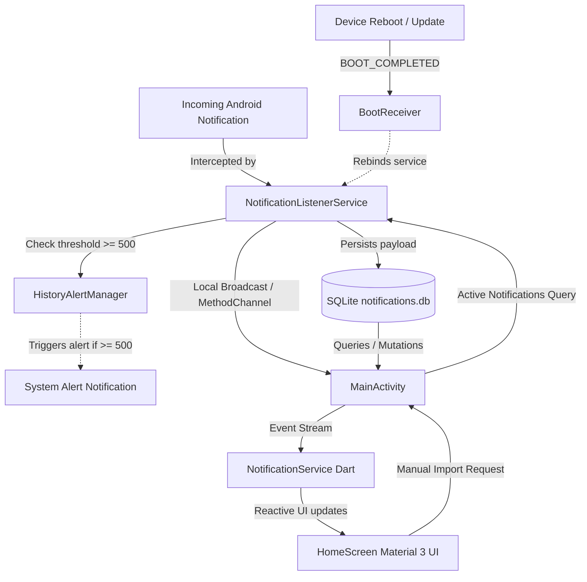

# fsavenotifications

[](https://flutter.dev)
[](https://developer.android.com)
[](https://kotlinlang.org)
[](https://www.sqlite.org)
[](LICENSE)
[](https://m3.material.io)

A fast, lightweight, and privacy-focused Android application built with **Flutter** and native **Kotlin** that captures, logs, and permanently preserves device notifications across reboots and app updates.

---

## 📖 Overview

On stock Android, once a notification is dismissed or the device restarts, its content is permanently lost. **fsavenotifications** solves this problem by running an efficient background `NotificationListenerService` that intercepts incoming notifications and stores them securely in a local on-device SQLite database.

Whether you want to recover mistakenly dismissed notifications, keep a persistent history of incoming messages, or audit system alerts, **fsavenotifications** provides a full notification center with zero cloud dependencies.

---

## ✨ Features

- 🔄 **Reboot & App Update Persistence**
  - All notifications are persisted in an indexed local SQLite database (`notifications.db`).
  - Automatically recovers and continues listening after device reboots or application updates (`.apk` or Google Play Store) via Android `BootReceiver`.
  - Permissions, battery exemptions, and SQLite database records remain 100% intact across app updates.

- 📥 **Two-Tab Inbox & History Interface**
  - **Unread Tab**: Active inbox displaying unread notifications with live count badges.
  - **History Tab**: Complete archive of previously read notifications.

- 📥 **On-Demand Active Notification Import ("Hae ilmoitusviestit")**
  - Pull all unread notifications currently sitting in the Android notification shade directly into the app on demand.
  - Accessible from the top app bar download icon (`download_for_offline`), the tools & tests dialog, or empty inbox button.
  - **Automated Duplicate Prevention**: Checks each notification against existing SQLite records by unique notification key, package name, title, text, and timestamp window (±3s). Messages already in unread or history are never duplicated.
  - **Self-Healing Rebind Engine**: Employs dynamic component toggling (`pm.setComponentEnabledSetting` & `requestRebind`) to ensure the listener connects reliably even after fresh installs or Android OS process restarts.

- 👆 **Intuitive Gestures & Quick Actions**
  - **Swipe to Mark Read**: Swipe any item in the Unread tab to move it into History.
  - **Swipe to Delete**: Swipe items in History to permanently erase them.
  - **Direct App Launch**: Tap the quick-launch icon or "Open app" button directly on any card or detail sheet to launch the originating app or trigger its active system notification intent.
  - **Interactive Links & URLs**: Automatically detects web URLs (`https://`, `http://`, `www.`) and email addresses in message text, making them clickable with dedicated link chips in the detail view.
  - **Detail View**: Tap any notification card to inspect full metadata in a bottom sheet (application name, package ID, exact arrival timestamp, full title, expanded body text, and interactive link chips).
  - **Bulk Actions**: One-tap "Mark all as read" (`done_all`) and "Clear history" (`delete_sweep`).

- 🔍 **Instant Search & Real-Time Filtering**
  - Real-time search bar filtering across application names, notification titles, and message bodies.

- ⚠️ **Automated History Maintenance (500+ Threshold Alert)**
  - Continuously monitors accumulated notifications.
  - Sends a high-priority system alert when 500 or more notifications accumulate in history.
  - Tapping the warning notification directly launches the application into the History tab for quick cleanup.
  - Features an in-app warning banner with a 1-click cleanup button.

- 📖 **Comprehensive Multilingual Help & User Guide**
  - In-app modal guide covering initial setup, active notification imports, background execution, and OEM-specific battery settings (Samsung One UI, Xiaomi MIUI/HyperOS, OnePlus/Oppo ColorOS).
  - Quick action buttons to directly open Notification Access settings, App Info, and Battery Optimization exception dialogs.

- 🌐 **Multi-Language Support (i18n)**
  - Automatically adopts the device language on launch.
  - Quick language switch dropdown from the top app bar supporting:
    - 🇬🇧 English (`en`)
    - 🇫🇮 Suomi (`fi`)
    - 🇸🇪 Svenska (`sv`)
    - 🇩🇪 Deutsch (`de`)

- 🎨 **Modern Material 3 UI**
  - Built with Flutter Material 3 design tokens, rounded surfaces, dynamic typography, and colored app avatars.
  - Native **Light** and **Dark** theme support.

- 🧪 **Built-in Developer & Test Suite**
  - Interactive test dialog to send custom push notifications.
  - On-demand active notification import test with duplicate count feedback.
  - Batch generator to populate 500 test messages to test threshold notifications and scrolling performance.
  - Manual trigger button for the history warning notification.

- 🔒 **100% Private & Offline**
  - Entirely offline. No internet permission (`android.permission.INTERNET` is not requested).
  - No analytics, tracking, or cloud sync. All data remains exclusively on your device.

---

## 🏗️ Architecture

The app uses a hybrid architecture combining Flutter's responsive UI with native Android background services:



### Key Components

- **Flutter / Dart Layer (`lib/`)**:
  - `HomeScreen` (`lib/screens/home_screen.dart`): Primary UI featuring unread/history tabs, search filtering, manual active notifications import, dismissal gestures, and theme management.
  - `NotificationService` (`lib/services/notification_service.dart`): Flutter platform interface managing `MethodChannel('com.metait.fsavenotifications/channel')`.
  - `SavedNotification` (`lib/models/saved_notification.dart`): Model representing notification records.
  - `LocaleService` & `AppStrings` (`lib/l10n/app_strings.dart`): In-memory localization, user help guide content, and runtime language switching.

- **Native Android Layer (`android/app/src/main/kotlin/`)**:
  - `NotificationListener` (`NotificationListener.kt`): Extends `NotificationListenerService` to capture status bar notifications, maintain active instance binding, and import active notifications with duplicate detection.
  - `NotificationDatabaseHelper` (`NotificationDatabaseHelper.kt`): Manages the local SQLite database (`notifications.db`), indexed queries, updates, and duplicate validation (`isNotificationAlreadySaved`).
  - `HistoryAlertManager` (`HistoryAlertManager.kt`): Manages warning threshold logic (500+ messages), notification channels, and deep-link routing.
  - `BootReceiver` (`BootReceiver.kt`): Listens for `ACTION_BOOT_COMPLETED` and `ACTION_MY_PACKAGE_REPLACED` to ensure background readiness across reboots and app updates.
  - `MainActivity` (`MainActivity.kt`): Handles platform channel method calls, intent extras (`open_tab`), permission checks, and background listener rebind management (`rebindNotificationListener`).

---

## 🗄️ Database Schema

Stored in `notifications.db`:

| Column | Type | Description |
| :--- | :--- | :--- |
| `id` | `INTEGER PRIMARY KEY AUTOINCREMENT` | Unique notification identifier |
| `notification_key` | `TEXT` | System notification key |
| `package_name` | `TEXT NOT NULL` | Application package identifier |
| `app_name` | `TEXT` | Resolved display name of source app |
| `title` | `TEXT` | Notification title |
| `text` | `TEXT` | Notification body / expanded text |
| `post_time` | `INTEGER NOT NULL` | Epoch timestamp (milliseconds) |
| `is_read` | `INTEGER DEFAULT 0` | Read state flag (`0` = unread, `1` = read) |
| `read_at` | `INTEGER DEFAULT 0` | Timestamp when marked as read |
| `is_ongoing` | `INTEGER DEFAULT 0` | Indicates sticky / ongoing notification |

*Indexes*: `idx_is_read` on `is_read`, `idx_post_time` on `post_time`.

---

## 🔑 Permissions Required

| Permission | Purpose |
| :--- | :--- |
| `BIND_NOTIFICATION_LISTENER_SERVICE` | Special Android permission required to listen to status bar notifications. Configured via system settings. |
| `POST_NOTIFICATIONS` | Runtime permission on Android 13+ (API 33+) to display history threshold alerts and test notifications. |
| `RECEIVE_BOOT_COMPLETED` | Allows the application to register receivers upon device boot and app update. |
| `REQUEST_IGNORE_BATTERY_OPTIMIZATIONS` | Prompts the system to exempt the app from aggressive battery optimizations so background listening is uninterrupted. |

---

## 🚀 Getting Started

### Prerequisites

- [Flutter SDK](https://docs.flutter.dev/get-started/install) (`^3.13.5` or higher)
- [Android SDK](https://developer.android.com/studio) (Target SDK 34 / 35, minimum Android 5.0 / API 21)
- Java / JDK 17

### Installation & Run

1. **Clone the repository:**
   ```bash
   git clone https://github.com/tkassila/fsavenotifications.git
   cd fsavenotifications
   ```

2. **Fetch Flutter dependencies:**
   ```bash
   flutter pub get
   ```

3. **Run on a connected Android device or emulator:**
   ```bash
   flutter run
   ```

4. **Grant Permissions (First Launch):**
   - When launching the app for the first time, a warning banner will appear requesting notification access.
   - Tap **Enable** (or navigate to *Settings > Apps > Special App Access > Notification Access*).
   - Locate **fsavenotifications** and enable the toggle.
   - *(Optional but recommended)*: Disable battery optimization in the built-in guide dialog to ensure continuous background operation on vendors with aggressive task killers.

### Building Release APKs

To build optimized release APKs split by architecture (reduces download and installation size):

```bash
flutter build apk --split-per-abi
```

Generated APKs will be located in `build/app/outputs/flutter-apk/`:
- `app-arm64-v8a-release.apk`
- `app-armeabi-v7a-release.apk`
- `app-x86_64-release.apk`

---

## 🛠️ Testing & Diagnostics

The app includes a built-in diagnostic and testing suite accessible via the Floating Action Button:

1. **Send Test Notification**: Post a custom title and body to verify listener capture and database storage.
2. **Import Active Notifications ("Hae ilmoitusviestit")**: Pull all unread notifications currently sitting in the device status bar into the inbox, automatically skipping duplicates.
3. **500 History Alert Trigger**: Manually fire the threshold alert to verify system notification channels and deep-linking to the History tab.
4. **Batch Generator**: Insert 500 test messages in one operation to stress-test UI responsiveness, database indexing, and warning banners.

---

## 📄 License

This project is licensed under the MIT License - see the [LICENSE](LICENSE) file for details.
